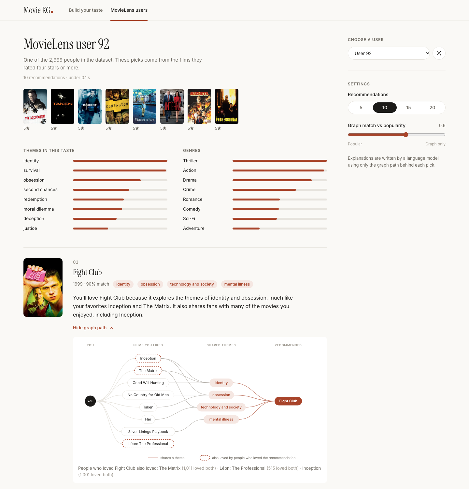

# Movie KG RecSys

**Graph-Based Knowledge Representation for Explainable Movie Recommendations**

Users, films, genres and LLM-extracted *themes* (such as "redemption" or "found family") live in a Neo4j knowledge graph. Recommendations combine two kinds of graph path: films that share themes with the ones you liked, and films that the same people loved (similarity links built from ratings). Every recommendation is explained from the actual paths behind it, by a language model that may only rephrase that evidence, or by a fixed template.



## Results at a glance

MovieLens 32M sample: 3,843 films (387 from 2020-2023), 2,999 users, 617k ratings, 95 themes. Leakage-free evaluation (graph built from train ratings only; weights chosen on a separate validation split), K = 10, 2,955 users:

| Method | Precision | Recall | NDCG | Hit rate |
|---|---|---|---|---|
| Popularity | 0.086 | 0.054 | 0.102 | 0.43 |
| Item-kNN | 0.122 | 0.086 | 0.149 | 0.56 |
| SVD | 0.116 | 0.080 | 0.142 | 0.56 |
| Graph, themes only | 0.024 | 0.016 | 0.028 | 0.20 |
| **Graph, themes + similarity (final)** | **0.129** | **0.091** | **0.159** | **0.58** |

Explanations (50 sampled): 100% mention only titles and themes from their evidence; every sampled recommendation has a theme path and a similarity path. Full numbers, method and limitations: `../PROJECT_REPORT_LOG.md`.

## Requirements

- Python 3.10-3.13 (3.12 recommended; the pinned packages don't support 3.14 yet).
- A Docker runtime for Neo4j:
  - macOS: [OrbStack](https://orbstack.dev/), [Docker Desktop](https://www.docker.com/products/docker-desktop/), or Colima (free, command line; see [Colima on macOS](#colima-on-macos)).
  - Windows: Docker Desktop (WSL 2 backend). Linux: Docker Engine with the Compose plugin.
- About 8 GB of RAM (Neo4j is capped at a 1 GB heap) and 3 GB of free disk.
- API keys (see [API keys](#api-keys)): TMDB (free) and an LLM provider with a little credit.

## Setup

```bash
cd movie-kg-recsys
python3.12 -m venv .venv
source .venv/bin/activate                 # Windows PowerShell: .venv\Scripts\Activate.ps1
pip install -r requirements.txt
pip install -r requirements-optional.txt  # sentence-transformers for theme normalization (pulls in torch)
cp .env.example .env                       # Windows: copy .env.example .env
```

Fill in `.env`. Set `NEO4J_PASSWORD` (8+ characters, no `$` or quotes) **before** the first Neo4j start. `.env` is git-ignored; never commit it.

```bash
docker compose up -d                      # Neo4j 5 Community; browser at http://localhost:7474
python config.py                          # expect every package "ok", settings "set", "Neo4j connection OK"
```

### Colima on macOS

```bash
brew install colima docker docker-compose docker-credential-helper
colima start --cpu 2 --memory 3 --disk 20 --vm-type vz
```

`~/.docker/config.json` needs `"cliPluginsExtraDirs": ["/opt/homebrew/lib/docker/cli-plugins"]` and `"credsStore": "osxkeychain"`. After a reboot run `colima start` before `docker compose up -d`.

## Run order

Run everything from `movie-kg-recsys/` with the venv active. Every API step is cached and resumable: a re-run never pays twice.

| # | Step | Command | Notes |
|---|---|---|---|
| 1 | Prepare the data | `python scripts/01_prepare_data.py` | Downloads MovieLens 32M (239 MB) once; samples 2,999 users and 3,864 films; train/test split by time |
| 2 | Fetch plots and posters | `python scripts/02_fetch_tmdb.py` | About 3,900 TMDB calls (~10 min) on a fresh start; try `--limit 5` first |
| 3 | Extract themes with the LLM | `python scripts/03_extract_themes.py` | One call per film: about 3,850 calls, roughly **$0.65 and 1.5-2 h** on a fresh start. Asks y/n first; try `--limit 10` |
| 4 | Normalize themes | `python scripts/04_normalize_themes.py` | Merges near-duplicates into 95 themes |
| 3+4 | Or both, unattended | `caffeinate -i bash scripts/overnight_extract.sh` | macOS; drop `caffeinate -i` elsewhere |
| 5 | Build the graph | `python scripts/05_build_graph.py --mode full --wipe` | About 50 s; prints counts and 10 checks |
| 6 | Use it | `uvicorn app.server:app --port 8000` | Open http://localhost:8000 |
| - | Command line | `python -m src.recommender --user 92` | `--ratings "1:5,2571:5,4993:4"` for a new profile; `--explain template` to skip the LLM |
| - | Tests | `pytest -q` | 41 tests, no paid calls; most need the full graph |

### Evaluation (optional, about 30 minutes, ~$0.02)

```bash
python scripts/05_build_graph.py --mode val --wipe     # tuning graph: earlier 80% of each user's train ratings
python scripts/06_evaluate_accuracy.py --split val     # weight grid -> results/validation_grid.csv
python scripts/05_build_graph.py --mode eval --wipe    # train ratings only (no test leakage)
python scripts/06_evaluate_accuracy.py                 # -> results/accuracy_results.csv and charts
python scripts/07_evaluate_explanations.py             # 50 explanations, ~50 LLM calls, asks y/n
python scripts/05_build_graph.py --mode full --wipe    # back to the demo graph
```

The graph records its mode; the evaluation scripts refuse to run on the wrong one, and switching modes needs `--wipe`.

## How it works

```
(User)-[:RATED {rating}]->(Movie)-[:HAS_THEME]->(Theme)
                          (Movie)-[:HAS_GENRE]->(Genre)
                          (Movie)-[:SIMILAR {score, coLikes}]->(Movie)
```

1. **Themes:** an LLM reads each film's TMDB plot (plus title, genres, tagline, user tags) and returns 3-5 themes, preferring a 50-theme seed list so films share a vocabulary. Normalization merges near-duplicates with sentence embeddings and drops themes on fewer than 3 films.
2. **Similarity links:** each film links to its 50 most similar films by rating patterns (adjusted cosine), computed from the same ratings the graph holds.
3. **Ranking:** for an unseen film, a theme score (your affinity for its themes × how rare each theme is) and a genre score form the content part; a similarity score sums its links to films you rated. `graph = 0.25 × content + 0.75 × similarity`, then `final = 0.6 × graph + 0.4 × popularity`. The weights were chosen on a validation split.
4. **Explanations:** the graph paths behind a recommendation become an evidence object (shared themes with the liked films that have them; liked films that the same people loved). The LLM writes 1-2 sentences using only that evidence; the template does it without an LLM. Texts are cached.
5. **New users:** the web app's liked films (counted as 5 stars) go into a temporary graph user that is deleted after each request.

Settings live in `config.py` (sample size, thresholds, `CF_WEIGHT`, `ALPHA`, themes per explanation, and so on).

## API keys

- **TMDB (free):** themoviedb.org → Settings → API. Put the v3 "API Key" (or the longer v4 "API Read Access Token") in `TMDB_API_KEY`.
- **LLM:** any OpenAI-compatible provider. Default NanoGPT: create a key at nano-gpt.com, add a few dollars, set `LLM_API_KEY` and `LLM_MODEL` (this project used `google/gemini-3.5-flash-lite`, about $0.30 / $2.50 per million tokens in / out). For OpenRouter set `LLM_BASE_URL=https://openrouter.ai/api/v1`. Every call is logged with tokens and cost in `data/cache/llm_usage.csv`.

## Project layout

```
movie-kg-recsys/
├── config.py                  # settings; run it for a setup check
├── docker-compose.yml         # Neo4j 5 Community (1 GB heap)
├── requirements.txt           # core packages (pinned); requirements-optional.txt: sentence-transformers, torch
├── scripts/                   # 01-07 pipeline and evaluation, overnight_extract.sh
├── src/                       # data, TMDB, LLM, themes, graph, recommender, explainer, baselines, evaluation
├── app/                       # server.py (FastAPI) + static/ (the web page)
├── tests/                     # smoke, pipeline and web tests
├── results/                   # stats, logs, charts, screenshots (report figures)
└── data/                      # raw/, cache/, processed/ (git-ignored; caches hold every paid API answer)
```

Back up `data/cache/` if you move the project: it holds every TMDB and LLM answer, so nothing has to be paid for again.

## Troubleshooting

- **`docker: command not found` / `Cannot connect to the Docker daemon`:** install or start the Docker runtime (`colima start`, or open OrbStack / Docker Desktop).
- **`error getting credentials ... docker-credential-desktop`:** leftover Docker Desktop config; install `docker-credential-helper` and set `"credsStore": "osxkeychain"` in `~/.docker/config.json`.
- **`Set NEO4J_PASSWORD in .env`:** run `docker compose` next to `.env`, with the password filled in.
- **Neo4j login fails after changing the password:** Neo4j keeps the first password. `docker compose down`, delete `neo4j_data/`, `docker compose up -d`, then rebuild the graph (step 5).
- **Port 7474 or 7687 in use:** another Neo4j is running; stop it, or change the left-hand ports in `docker-compose.yml` and `NEO4J_URI`.
- **The page says it can't reach Neo4j:** `docker compose ps`; start it, then reload.
- **The page warns about eval or val mode:** an evaluation graph is loaded; run `python scripts/05_build_graph.py --mode full --wipe`.
- **TMDB 401:** the key is wrong or has spaces; both the v3 key and the v4 token work.
- **LLM HTTP 401 / 402 / 404:** bad key / no credit / unknown model id. HTTP 429 or 5xx are retried automatically; explanations fall back to the template if the LLM stays unavailable.
- **"Unauthenticated requests to the HF Hub" warning:** harmless; it appears when the sentence-embedding model is loaded.
- **`pip install` fails on Python 3.14:** use Python 3.12.

## Credits

- This product uses the TMDB API but is not endorsed or certified by TMDB.
- MovieLens data: F. Maxwell Harper and Joseph A. Konstan. 2015. The MovieLens Datasets: History and Context. *ACM Transactions on Interactive Intelligent Systems* 5(4), Article 19.
